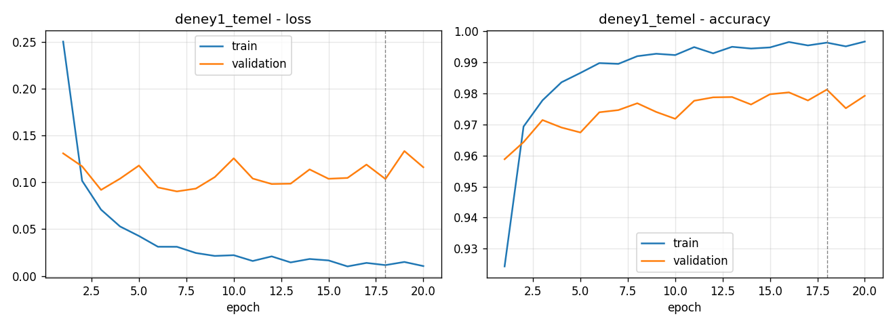
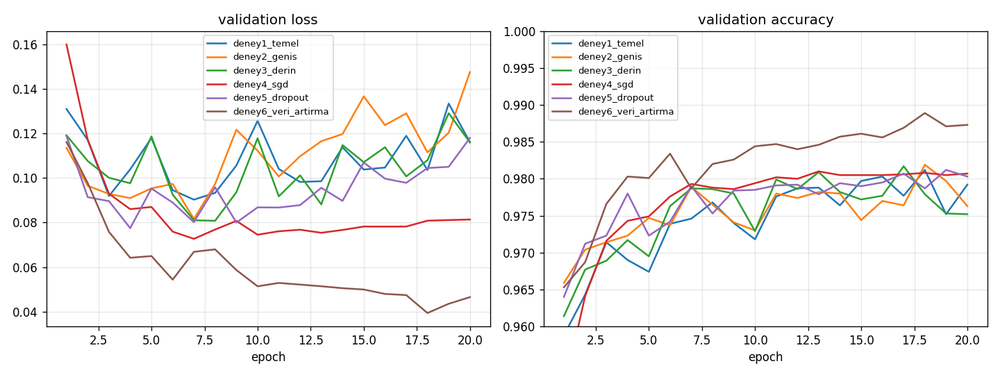
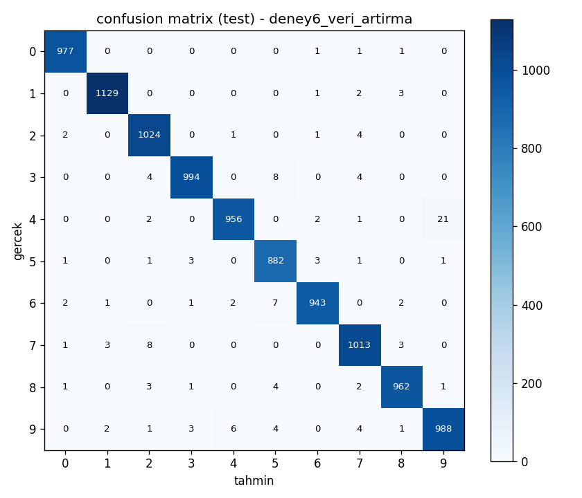
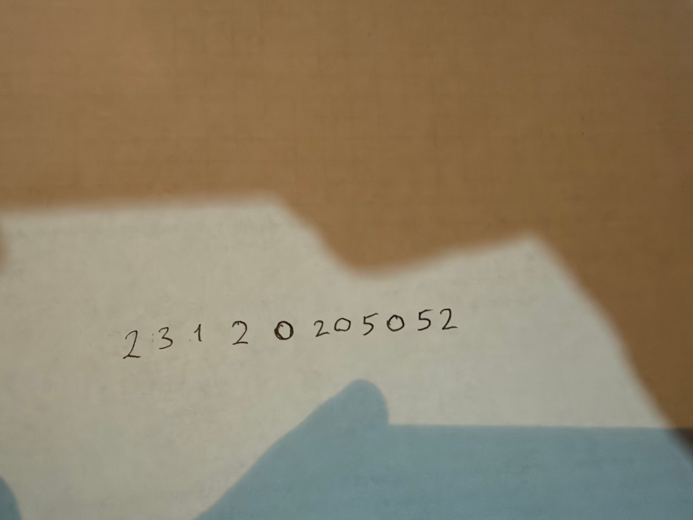
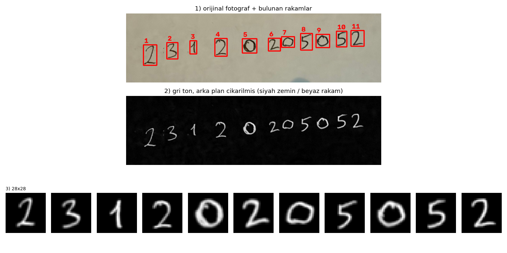
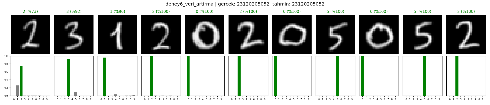

# MNIST ile MLP Tabanlı El Yazısı Rakam Tanıma

MNIST veri seti üzerinde PyTorch ile sıfırdan eğitilen MLP modelleri. Farklı yapılandırmalar karşılaştırıldı, en iyi model kendi el yazımla yazdığım okul numaram üzerinde test edildi. CNN veya hazır eğitilmiş model kullanılmadı.

## Proje yapısı

```
data.py          MNIST yükleme, train/val/test ayrımı, normalizasyon
model.py         MLP modeli
train.py         deneyleri eğitir, grafik ve sonuç tablolarını üretir
preprocess.py    el yazısı fotoğrafını MNIST formatına çevirir
predict.py       işlenmiş rakamları eğitilen modellerle tahmin eder
el_yazisi/       okul numaramın fotoğrafı ve işlenmiş 28x28 rakamlar
sonuclar/        modeller, grafikler, sonuç tabloları
```

## Çalıştırma

```bash
python3 -m venv .venv
source .venv/bin/activate
pip install -r requirements.txt

python train.py
python preprocess.py el_yazisi/ham/ogrenci_no.jpg
python predict.py --gercek 23120205052
```

`train.py` tek bir deney için de çalıştırılabilir: `python train.py --deney deney1_temel`

## Veri seti ve ayrım

| Küme | Kaynak | Görüntü sayısı |
|---|---|---|
| Train | MNIST train setinin 50.000'i | 50.000 |
| Validation | MNIST train setinden ayrılan 10.000 (seed = 42) | 10.000 |
| Test | MNIST test seti | 10.000 |

Görüntüler [0, 1] aralığına getirilip MNIST ortalaması (0.1307) ve standart sapmasıyla (0.3081) normalize edildi. Her deneyde validation doğruluğunun en yüksek olduğu epoch'taki ağırlıklar kaydedildi, en iyi deney de validation doğruluğuna göre seçildi. Test seti eğitim ve model seçimi sırasında hiç kullanılmadı, sadece tüm eğitimler bittikten sonra bir kez değerlendirildi.

## Hiperparametreler

Tüm deneylerde ortak:

| Parametre | Değer |
|---|---|
| Giriş | 784 (28x28 düzleştirilmiş) |
| Çıkış | 10 sınıf |
| Aktivasyon | ReLU |
| Loss | CrossEntropyLoss |
| Epoch | 20 |
| Batch size | 64 |
| Seed | 42 |
| SGD momentum (deney 4) | 0.9 |

Deneylere göre değişenler:

| Deney | Gizli katmanlar | Dropout | Optimizer | Learning rate | Veri artırma |
|---|---|---|---|---|---|
| deney1_temel | 256-128 | 0 | Adam | 0.001 | yok |
| deney2_genis | 512-256 | 0 | Adam | 0.001 | yok |
| deney3_derin | 512-256-128 | 0 | Adam | 0.001 | yok |
| deney4_sgd | 256-128 | 0 | SGD | 0.01 | yok |
| deney5_dropout | 512-256 | 0.2 | Adam | 0.001 | yok |
| deney6_veri_artirma | 512-256 | 0.2 | Adam | 0.001 | var |

Veri artırmada eğitim görüntülerine her batch'te rastgele ±12° döndürme, ±%10 ölçekleme ve ±%10 kaydırma uygulandı. Validation ve test görüntülerine uygulanmadı.

## Deney 1 – Temel MLP

784 → 256 → 128 → 10, ReLU, Adam (lr = 0.001).

| Metrik | Değer |
|---|---|
| Training loss | 0.0116 |
| Validation loss | 0.1036 |
| Training accuracy | %99.63 |
| Validation accuracy | %98.12 |
| Test accuracy | %98.11 |
| Eğitim süresi | 42.5 sn (20 epoch, Apple M4, MPS) |

Değerler en iyi epoch'a (18) aittir.



Train loss sürekli düşerken validation loss 3-4. epoch'tan sonra düşmüyor, hatta dalgalanarak biraz artıyor. Train accuracy %99.6'ya çıkarken validation %98 civarında kalıyor. Model birkaç epoch sonra ezberlemeye (overfitting) başlıyor.

## Yapılandırmaların karşılaştırılması

| Deney | Parametre | En iyi epoch | Train loss | Val loss | Train acc | Val acc | Test acc | Süre (sn) |
|---|---|---|---|---|---|---|---|---|
| deney1_temel | 235,146 | 18 | 0.0116 | 0.1036 | 0.9963 | 0.9812 | 0.9811 | 42.5 |
| deney2_genis | 535,818 | 18 | 0.0124 | 0.1115 | 0.9964 | 0.9819 | 0.9793 | 47.9 |
| deney3_derin | 567,434 | 17 | 0.0132 | 0.1007 | 0.9959 | 0.9817 | 0.9811 | 71.1 |
| deney4_sgd | 235,146 | 13 | 0.0018 | 0.0754 | 0.9999 | 0.9810 | 0.9833 | 16.3 |
| deney5_dropout | 535,818 | 19 | 0.0328 | 0.1050 | 0.9902 | 0.9812 | 0.9818 | 62.6 |
| **deney6_veri_artirma** | 535,818 | 18 | 0.0889 | 0.0394 | 0.9732 | **0.9889** | **0.9868** | 90.7 |



Her deneyin kendi loss/accuracy grafiği `sonuclar/<deney_adi>/grafik.png` içinde.

En iyi modelin (deney 6) test setindeki confusion matrix'i:



## Kendi el yazımla test

Okul numaramı (23120205052) beyaz kağıda tükenmez kalemle yazıp telefonla fotoğrafını çektim.



`preprocess.py` adımları:

1. Fotoğraf gri tona çevrilir.
2. Morfolojik kapama ile kağıdın arka planı (ışık, gölge) tahmin edilip görüntüden çıkarılır. Böylece arka plan siyah, mürekkep beyaz olur, yani MNIST'teki gibi.
3. Otsu eşikleme ve bağlı bileşen analizi ile rakamlar bulunur, soldan sağa sıralanır. Küçük noktalar elenir.
4. Her rakam kırpılır, çizgi kalınlığı MNIST'e benzesin diye biraz kalınlaştırılır, en-boy oranı korunarak 20x20 kutuya sığdırılır.
5. 28x28 siyah tuvale yerleştirilip kütle merkezi ortaya (14,14) kaydırılır. MNIST de bu şekilde hazırlanmış.
6. Piksel değerleri [0, 1] aralığına getirilir. Modele verilmeden önce MNIST ortalaması ve standart sapmasıyla normalize edilir (`predict.py`).



İşlenmiş rakamlar tek tek `el_yazisi/islenmis/` klasöründe.

### Sonuç

| Deney | Tahmin | Doğru rakam |
|---|---|---|
| deney1_temel | 23120205052 | 11/11 |
| deney2_genis | 23120205052 | 11/11 |
| deney3_derin | 23120205052 | 11/11 |
| deney4_sgd | 23120205052 | 11/11 |
| deney5_dropout | 23120205052 | 11/11 |
| deney6_veri_artirma | 23120205052 | 11/11 |



Rakam bazında olasılıklar `sonuclar/el_yazisi_sonuc.md` dosyasında.

## Genel değerlendirme

- Tüm yapılandırmalar MNIST test setinde %98 civarına ulaştı. MNIST basit bir veri seti olduğu için iki gizli katmanlı küçük bir MLP bile yüksek başarı veriyor.
- Katmanları genişletmek (deney 2) veya bir katman eklemek (deney 3) parametre sayısını iki katından fazla artırdı ama doğruluğu neredeyse hiç değiştirmedi. Sadece eğitim süresi uzadı. Bu veri seti için 256-128'lik ağ yeterli kapasitede.
- SGD + momentum (deney 4) en hızlı eğitilen model oldu ve Adam ile aynı validation doğruluğuna ulaştı. Ama train accuracy %99.99'a çıktı, model eğitim verisini tamamen ezberledi.
- Veri artırma olmayan deneylerde train loss 0'a yaklaşırken validation loss yerinde saydı. Overfitting açıkça görülüyor. Dropout (deney 5) train ile validation arasındaki farkı biraz kapattı ama validation doğruluğunu artırmadı.
- En büyük iyileşme veri artırmayla (deney 6) geldi. Validation %98.1'den %98.9'a, test %98.7'ye çıktı, validation loss 0.10'dan 0.04'e indi. Bu modelde train accuracy validation'dan düşük, çünkü eğitim görüntüleri rastgele bozulduğu için daha zor. Model ezberlemek yerine genellemeyi öğreniyor.
- Confusion matrix'te en çok karışan rakamlar 4-9, 7-2 ve 3-5. Bunlar şekil olarak birbirine benzeyen rakamlar.
- Kendi el yazımla yazdığım 11 haneli numaranın tamamı bütün modellerde doğru tahmin edildi. Bunda ön işlemenin rolü büyük. MLP pikselleri doğrudan girdi olarak aldığı için kayma ve boyut farklarına çok hassas, bu yüzden rakamların MNIST'teki gibi ortalanıp ölçeklenmesi gerekiyor. CNN'den farklı olarak MLP'de konumdan bağımsızlık yok, rakam birkaç piksel kaysa bile giriş vektörü tamamen değişiyor.
- En düşük güven ilk rakamda (2, %73). O rakamı eğik ve ince yazmışım, model %26 ihtimalle 1 dedi. Diğer rakamların çoğu %99 üzeri güvenle bilindi.
- Sonuç olarak doğru ön işleme ve veri artırma ile basit bir MLP bile gerçek el yazısında iyi çalışıyor. Ama farklı kağıt, kalem veya yazı stilinde başarı CNN'e göre daha kırılgan olur.
